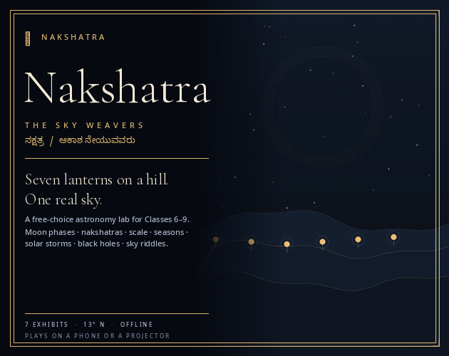
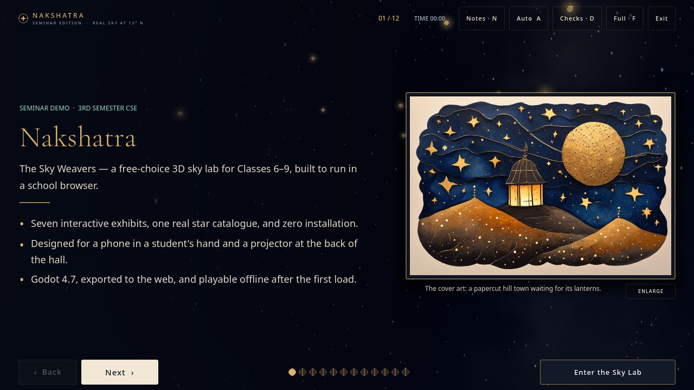

# Nakshatra — The Sky Weavers

**A hand-crafted 3D sky lab for curious middle-school minds (Classes 6–9).**
Seven lanterns, one real sky, and no forced path: every exhibit is open from the
first second.

Built with **Godot 4.7.2** and exported for the **Web (HTML5)**. It runs on
itch.io, a classroom projector, a school laptop or a phone. No install, no
account, no network calls at play time.

**Play the current build:** https://g1gowda123.github.io/nakshatra/  
**Source:** https://github.com/g1gowda123/nakshatra

**v1.7.0 — Signal.** A signal-receiver interface built from a dithered camera feed, a tracking/receipt index and one acid accent. Under it: a verified Moon-phase model, a quiz that shuffles
its answers, a take-home certificate, keyboard access, reduced motion, and a
deck that survives its own live-demo loop.
The same build includes a twelve-slide presenter deck with speaker notes, a
timer, auto-advance, a pre-flight check and one-click jumps into the live
exhibits. The deck also takes per-slide deep links (`?scene=seminar&slide=8`)
and has a printable one-page handout. See
[`docs/ART_DIRECTION.md`](docs/ART_DIRECTION.md),
[`docs/SEMINAR_PLAYBOOK.md`](docs/SEMINAR_PLAYBOOK.md) and
[`docs/HANDOUT.md`](docs/HANDOUT.md).



---

## Presenting this project

Open the game, choose **Seminar mode** on the title screen, or go straight to:

```text
https://g1gowda123.github.io/nakshatra/?scene=seminar
```

The same build runs locally from `nakshatra/build/web/` (see below) when the
venue has no internet.

Then:

- **→ / Space / PageDown** — next slide. **← / PageUp** — back.
- **N** — one-sentence cue. **Shift+N** — full speaker notes. **D** — pre-flight checks, shortcuts, demo state.
- **F** — fullscreen. **L** — open the live exhibit on this slide.
- **I** or click the figure — enlarge the architecture diagram or any screenshot.
- **A** — auto-advance. **P** — pause the timer. **Esc** — back to the Sky Lab.

The deck remembers its slide **and its timer** in the local save. Open an exhibit,
demo it, press **Backspace** (or the gold **PRESENT · DECK** link), and the deck
resumes where you stopped. **Home** restarts the deck and the clock.

Start with [`docs/DEMO_CARD.md`](docs/DEMO_CARD.md) for the printable one-page
route, then [`docs/SEMINAR_PLAYBOOK.md`](docs/SEMINAR_PLAYBOOK.md) for the full
script and failure playbook. [`docs/VIVA_QA.md`](docs/VIVA_QA.md) has thirty
answers for the questions after the demo.



---

## Project at a glance

| | |
|---|---|
| Audience | Classes 6–9, teachers, a classroom projector or a phone |
| Exhibits | 7 (Moon, constellations, solar system, seasons, solar storms, black holes, quiz) |
| Sky data | 8,879 naked-eye stars (HYG v3); 88 IAU constellations; 28 nakshatras (Stellarium) |
| Content | 14 explained questions, 10 Field Guide cards, 5 constellation hunts, 8 planet fact sheets |
| Seminar mode | 12 slides, speaker notes, timer, auto-advance, pre-flight, figure zoom |
| Engine | Godot 4.7.2 · GL Compatibility · Web export · threads disabled |
| Runtime | One static folder; no server, no accounts, no analytics, no network calls |
| Licence | GPL-3.0-or-later (combined work); see [`CREDITS.md`](CREDITS.md) |

The current numbers are generated by `python tools/project_stats.py` and kept in
[`docs/STATS.md`](docs/STATS.md). For the talk itself: the run sheet is
[`docs/SEMINAR_PLAYBOOK.md`](docs/SEMINAR_PLAYBOOK.md), the one-page card is
[`docs/DEMO_CARD.md`](docs/DEMO_CARD.md), the printable fallback is
[`docs/SPEAKER_NOTES.md`](docs/SPEAKER_NOTES.md), and the audience takeaway is
[`docs/HANDOUT.md`](docs/HANDOUT.md). A teacher-facing 45-minute lesson is in
[`docs/LESSON_PLAN.md`](docs/LESSON_PLAN.md).

---

## What is in the box

- **The Sky Lab** — a 3D hilltop at night with seven glowing lanterns and an
  observatory. Every lesson is directly reachable. The hill, lanterns, paper
  shaders and sky are hand-built in code; the art direction is documented in
  [`docs/ART_DIRECTION.md`](docs/ART_DIRECTION.md).
- **Seminar mode** — a twelve-slide presenter walkthrough with speaker notes,
  a rehearsal timer, per-slide auto-advance, a pre-flight checklist, demo-state
  and reset controls, figure zoom, and buttons that open each real exhibit.
- **The Moon's Mask** — drag the Moon around Earth; a live “from Earth” inset
  shows the true phase. Four challenges: waxing crescent, first quarter, full
  moon, waning crescent.
- **Thread the Stars** — hunt for **Saptarishi, Mriga, Sharmishtha, Vrishchika
  and Hamsa** in a real star field. Tap three stars to thread the pattern; each
  unlocks its story and science.
- **The Long Road** — an orrery with planet facts, true-distance and true-size
  comparisons, and four riddles. Light-minutes make the emptiness feel real.
- **The Turning Year** — tilt Earth, orbit it, and watch daylight and the noon
  Sun change at 13°N. Includes a “no tilt” experiment that makes the seasons
  disappear.
- **Solar Storm Lab** — build magnetic stress, release a flare, race a coronal
  mass ejection to Earth, protect a satellite and explain why the aurora arrives
  after the light.
- **Black Hole Lab** — change a black hole's mass, lower a probe toward the event
  horizon, and watch gravitational time dilation slow its clock. The visual is
  built around the physics of the EHT image of M87*; the Field Guide card uses
  the real EHT image with attribution.
- **Sky Riddles** — fourteen questions, no timer, shuffled options, an
explanation after every answer, a **Revise** link to the exhibit that teaches it,
and a one-click **CSV** of the attempt for a teacher. Designed to be used as a
**pre-test and post-test**.
- **Field Guide to the Universe** — written, illustrated cards on nebulae,
  supernovae, pulsars, galaxies, gravitational waves and exoplanets.
- **Sky Atlas** — the real sky at 13°N with the 88 IAU constellations,
  28 nakshatras, star labels, a time slider that uses the actual local
  sidereal time, and a **Tonight** card that names four stars above the
  horizon right now.
- **Eclipse Lab (bonus)** — a shadow-geometry model reachable from the Moon lab
  and the Field Guide: tilt the Moon's orbit, watch the umbra miss or land, and
  switch between a solar and a copper lunar eclipse.
- **The Story** — an optional four-panel lantern-festival story. It never gates
  a lesson.
- **The Finale** — when all seven lanterns are lit, a certificate and a sky full
  of rising lanterns.

The sky uses the **HYG catalogue** (8,879 naked-eye stars) and constellation /
nakshatra line data from **Stellarium**. Sizes and distances are real numbers;
the orrery is deliberately compressed so all eight planets can share a screen.

---

## Curriculum links

| Exhibit | Middle-school topic | A little above the textbook |
|---|---|---|
| The Moon's Mask | Moon phases; Earth–Moon–Sun geometry (Class 8 Science, *Stars and the Solar System*) | terminator, 29.5-day synodic month, why the far side is not “dark” |
| Thread the Stars | Constellations; nakshatras (same chapter) | star distances, red/blue supergiants, line-of-sight patterns changing over millennia |
| The Long Road | The solar system; planet order and scale (Classes 6–8) | light-minutes, why Venus is hotter than Mercury, 1,300 Earths inside Jupiter |
| The Turning Year | Motions of the Earth; seasons and day length (Class 6 Geography) | axial tilt vs distance, noon-Sun altitude at 13°N, solstices/equinoxes |
| Solar Storm Lab | The Sun; magnetism and space weather (enrichment) | magnetic reconnection, CME travel time, auroras, the Carrington Event, Aditya-L1 |
| Black Hole Lab | Gravity, light and time (enrichment) | event horizon radius, accretion disks, gravitational time dilation, EHT and LIGO |
| Sky Riddles | Revision | explanations, not just scores |
| Field Guide | Deep-sky enrichment | nebulae, supernovae, neutron stars, galaxies, gravitational waves, exoplanets |

**Kannada key terms and module names** sit beside the English; the player can
switch to **ಕನ್ನಡ** mode for Kannada module names. This is a term layer, not a
full UI translation — an honest limitation and a clear next step.

---

## Controls

### Playing

- **Mouse / touch**: drag to look around, tap stars and planets, drag the Moon,
  use sliders.
- **Buttons**: every action has a large, touch-friendly button; no keyboard is
  required.
- **Phone**: portrait is the primary layout; landscape also works. Sound starts
  after the first tap (browser autoplay rules).
- **Back**: the `‹` button returns to the Sky Lab. The browser back button is not
  required.

### Presenting (Seminar mode)

| Input | Action |
|---|---|
| `→` `Space` `PageDown` | Next slide |
| `←` `PageUp` | Previous slide |
| `Home` / `End` | First / last slide |
| `N` | One-sentence cue (projector-safe) |
| `Shift+N` | Full speaker notes |
| `A` | Auto-advance |
| `D` | Checks, shortcuts, demo state, reset |
| `F` | Fullscreen |
| `L` | Open the live exhibit on this slide |
| `I` | Enlarge the current figure |
| `P` | Pause / resume the timer |
| `Backspace` | From a live exhibit: return to the deck at the same slide |
| `Esc` | Close an overlay, then return to the Sky Lab (last slide: title) |
| Click the figure | Enlarge it |

---

## Run locally

```bash
cd nakshatra
godot --path .            # open in the editor
# or
godot --path . scenes/Boot.tscn
```

The web build is in `nakshatra/build/web/`. Serve it with any static server (not
`file://`):

```bash
cd nakshatra/build/web
python3 -m http.server 8060
# http://127.0.0.1:8060/index.html
# deck: http://127.0.0.1:8060/index.html?scene=seminar
```

The export includes `sw.js` and `manifest.webmanifest`. After the first load the
browser caches the HTML, WASM, PCK, worklets and icons, so a reload with the
network off still starts; the manifest also adds **Seminar deck** and **Sky Lab**
home-screen shortcuts. Serve over HTTP/HTTPS, never `file://`.

For a native seminar run without a browser:

```bash
godot --path nakshatra -- --screen=seminar
```

`--screen=` also accepts `lab`, `moon`, `stars`, `scale`, `seasons`, `flares`,
`blackhole`, `quiz`, `atlas`, `finale`, `guide`, `seminar` and `present`.

---

## Build & export

Requirements: Godot **4.7.2** with Web export templates, Python 3 with
Pillow/numpy for the art and data tools.

```bash
# 1. Rebuild the compact star catalogue from data_src/ (HYG + Stellarium)
python tools/build_sky_data.py

# 2. (Optional) regenerate the art, audio and seminar figures
python tools/make_art.py             # ComfyUI on http://127.0.0.1:8188
python tools/make_audio.py
python tools/make_plates.py          # engraved almanac plates (Pillow)
python tools/make_store_cover.py     # itch cover from the title plate
python tools/make_seminar_assets.py  # deck screenshots, crops, architecture figure

# 3. Export, brand the loader, package the itch zip and refresh stats
bash tools/build_web.sh

# Optional: regenerate the itch store screenshots from the current captures
python tools/sync_itch_shots.py
```

`build_web.sh` creates `nakshatra/build/web/`, uses an absolute export path, and
refreshes `docs/STATS.md`. It does not upload anything.

The export uses the **GL Compatibility** renderer and **threads disabled**, so it
runs on itch.io without special COOP/COEP headers and on phones without
`SharedArrayBuffer`.

---

## Tests

```bash
bash tools/run_tests.sh
```

This runs six headless contract tests:

- `tests/TestContent.tscn` — 7 modules, 14 questions, 8 planets, 10 Field Guide
  cards, 5 hunts, 4 scale riddles, 12 seminar slides, every image and lab path,
  and the sky counts.
- `tests/TestSeminar.tscn` — the deck opens, every slide has content and a note,
  pre-flight is green, speaker notes and figure zoom work, and the number
  formatting is correct.
- `tests/TestSolarFlow.tscn` — an unshielded flare asks for the shield, a
  shielded flare reaches the challenge, and the stage stays stable.
- `tests/TestMoonFlow.tscn` — the five cardinal phases, the orbit direction,
  the corrected geometry feedback, and the hidden challenge readout.
- `tests/TestQuizFlow.tscn` — options stay a permutation, the correct index is
  remapped, the answer moves between positions, a wrong choice records the
  real answer and its revise topic, and every attempt is stored for the CSV.
- `tests/TestSky.tscn` — the horizon transform puts Polaris, Capella, Sirius,
  Fomalhaut and Arcturus at their textbook altitudes and keeps the south
  celestial pole below the horizon.

Visual work uses `tests/Capture.tscn`, a dev-only harness that loads any scene at
a fixed size and saves a PNG. It is not part of the export.

---

## Documentation

| Document | Contents |
|---|---|
| [`docs/SEMINAR_PLAYBOOK.md`](docs/SEMINAR_PLAYBOOK.md) | Ten-minute run sheet, slide-by-slide script, live-demo routes, failure playbook, five-minute cut |
| [`docs/DEMO_CARD.md`](docs/DEMO_CARD.md) | One printable page for the presenter |
| [`docs/ARCHITECTURE.md`](docs/ARCHITECTURE.md) | Runtime, data pipeline, rendering, save format, build and extension guide |
| [`docs/FEATURE_MATRIX.md`](docs/FEATURE_MATRIX.md) | Feature-to-syllabus map, claims and evidence, deliberate omissions |
| [`docs/VIVA_QA.md`](docs/VIVA_QA.md) | Thirty questions with answers, numbers to know, contribution template |
| [`docs/STATS.md`](docs/STATS.md) | Generated project numbers |
| [`docs/README.md`](docs/README.md) | Index and repository map |

---

## Repo layout

```text
.
├── nakshatra/              # the Godot project
│   ├── scenes/             # Boot, Sky Lab, 7 exhibits, Atlas, Finale, Seminar
│   ├── scripts/            # autoloads + one script per scene
│   ├── shaders/            # sky, star, planet, Earth, Moon, Sun, disk, lines
│   ├── data/               # content.json + compact sky catalogue
│   ├── assets/             # art, fonts, seminar figures, FX
│   ├── audio/              # synthesised ambience and interface sounds
│   ├── tests/              # headless tests + capture harness
│   └── build/web/          # exported static site
├── tools/                  # data, art, audio, build, stats and test scripts
├── itch/                   # store assets and the packaged zip
├── docs/                   # playbook, architecture, feature matrix, viva Q&A
├── README.md
├── CREDITS.md
└── CHANGELOG.md
```

---

## Uploading to itch.io

1. Create a new project → **HTML**.
2. Upload `itch/nakshatra-web.zip` and tick **“This file will be played in the
   browser”**.
3. Set the viewport to **1280 × 720**; enable **mobile friendly** and
   **fullscreen button**.
4. Use `itch/cover.png` as the cover and the `itch/0*.png` files as screenshots.
   The seminar deck screenshots are listed in `itch/description.md`.
5. Suggested tags: `educational`, `astronomy`, `space`, `godot`,
   `middle-school`, `india`, `kannada`, `science`.

---

## Credits and licences

- **Sky data**: HYG Database v3 by David Nash (`astronexus.com`),
  **CC BY-SA 4.0**. Constellation and nakshatra line data from **Stellarium
  skycultures**, **GPL-2.0-or-later**. The packaged sky data is distributed under
  the same share-alike terms; see `CREDITS.md`.
- **Illustrations**: original papercut art for the story and finale, plus
  code-drawn engraved plates (`tools/make_plates.py`) for the seven exhibits and
  the cover. No stock images.
- **Type**: Anton, Cormorant Garamond, Noto Sans, Noto Sans Kannada —
  **SIL Open Font License**.
- **Code, shaders, UI, seminar deck and audio**: original for this project. The
  audio is synthesised locally (ambient pad, chimes, UI sounds).
- **Engine**: Godot Engine 4.7.2, MIT.
- **Two astronomy cards**: NASA/SDO (public domain) and the Event Horizon
  Telescope Collaboration (CC BY 4.0); full attribution in `CREDITS.md`.

All facts were checked against NASA Solar System Exploration, NASA/ESA star data,
and NCERT/State syllabus topics. If you spot a factual error, please open an
issue — accuracy matters more than polish.

---

## Design notes

- **Free choice is the point.** There is no level lock, no forced order, and no
  “complete the story to learn”. The story is a wrapper, not a gate.
- **An observatory almanac, torn out and taped to a wall.** `scripts/UI.gd`
  holds the whole visual system: ink ground, cream paper modals, acid-yellow
  attention, vermilion stamps, hard offset shadows and square corners. Anton
  carries the headings and controls; Noto Sans carries the reading. Every
  button lifts, squashes and sparks; every result earns a stamp.
- **One real sky.** The stars are not a decorative texture: positions,
  brightnesses and colours come from the HYG catalogue. Constellation lines are
  the official IAU figures; nakshatra lines are from Stellarium's Indian
  skyculture.
- **Explain first.** Every exhibit opens with a written Sky Note; the
  interaction comes after the idea.
- **Phones first.** Every screen has a portrait layout; the content-scale system
  uses the browser's CSS size so 16 px type stays 16 px on a high-DPI phone.
- **No SVGs.** All art is raster (WebP/PNG), all icons are drawn in code, and the
  UI uses a small set of fonts with Kannada fallbacks.
- **Offline.** The game makes no network calls at runtime.
- **A deck inside the game.** The seminar mode is a scene, not a separate app:
  it uses the same fonts, the same sky and the same data, and its buttons open
  the real exhibits.

Made for the Community Project / 3rd Semester CSE brief, and built as a real
thing that a classroom can keep.
