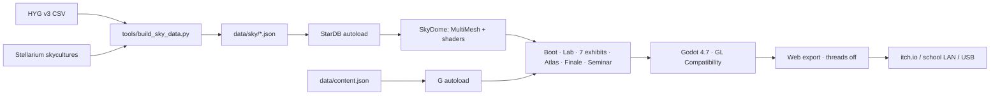

# Architecture

Nakshatra is a Godot 4.7 project exported as a static web build. This document
explains the runtime, the data pipeline, the rendering choices, the seminar
layer, and the trade-offs behind them.

The one-sentence version: **everything is computed in the browser from compact
data baked at build time; no server is involved at play time.**

---

## 1. Constraints that shaped the design

| Constraint | Consequence |
|---|---|
| Must run on a school laptop, projector and low-end phone | Web export, GL Compatibility renderer, portrait-first UI, no post-processing |
| Must work without internet after loading | No API calls, no CDN, no fonts fetched at runtime, one static folder |
| No accounts, no analytics | Progress in `user://` (IndexedDB on the web) |
| The sky must be real, not a texture | HYG catalogue loaded into packed arrays; MultiMesh star field |
| A teacher must be able to present it | In-game Seminar mode with speaker notes, timer, pre-flight and deep links |
| The project must be inspectable by a viva panel | Data-driven content, plain JSON, documented pipeline, headless tests |

---

## 2. System at a glance



There is no backend, database, authentication layer or telemetry. The exported
build is HTML, JavaScript, WebAssembly, a `.pck` archive and the audio worklets.

---

## 3. Runtime map

### Autoloads (`project.godot`)

| Autoload | Script | Responsibility |
|---|---|---|
| `G` | `scripts/G.gd` | Language, progress, quiz best, save file, content JSON, version, demo-state helper |
| `StarDB` | `scripts/Sky.gd` | Loads the compact star catalogue and constellation/nakshatra line data into packed arrays |
| `Sfx` | `scripts/Sfx.gd` | Ambient bed and pooled one-shot sounds; starts after the first gesture (browser rule) |
| `Router` | `scripts/Router.gd` | Fade-to-black scene changes that survive `change_scene_to_file` |

`G` loads `data/content.json` in `_ready`. Everything written in the game —
lessons, quiz questions, planet facts, field-guide cards, seminar slides — comes
from that file. `StarDB` loads the sky data separately because it is large and
only the sky components need it.

### Scenes

| Scene | Script | Role |
|---|---|---|
| `Boot.tscn` | `Boot.gd` | Title, real star field, story/teacher/credits, hidden `?scene=` routes |
| `Lab.tscn` | `Lab.gd` | 3D hilltop hub: seven lanterns, observatory, path, cards |
| `MoonLab.tscn` | `MoonLab.gd` | Moon-phase geometry, drag interaction, live Earth inset |
| `StarLab.tscn` | `StarLab.gd` | Constellation hunts on the real sky |
| `ScaleLab.tscn` | `ScaleLab.gd` | Orrery, scale/size/data views, planet riddles |
| `SeasonLab.tscn` | `SeasonLab.gd` | Tilt, orbit, noon-Sun altitude and day length at 13°N |
| `SolarLab.tscn` | `SolarLab.gd` | Magnetic stress, flare, CME race, satellite shield |
| `BlackHoleLab.tscn` | `BlackHoleLab.gd` | Mass, event horizon, probe, time dilation |
| `QuizLab.tscn` | `QuizLab.gd` | 14 questions, explanations, pre/post use |
| `Atlas.tscn` | `Atlas.gd` | Real sky at 13°N, 88 constellations, 28 nakshatras, time slider |
| `Finale.tscn` | `Finale.gd` | Certificate and rising lanterns |
| `Seminar.tscn` | `Seminar.gd` | Presenter deck: 12 slides, notes, timer, pre-flight, figure zoom |

The 3D scenes build their contents in code. `.tscn` files are deliberately tiny
(root + script), which keeps scene files reviewable and avoids hidden editor
state.

### Content flow

```text
data/content.json
 ├── modules{}         → module cards, briefings, in-lab lesson panels
 ├── quiz[]            → QuizLab
 ├── planets[]         → ScaleLab
 ├── scale_riddles[]   → ScaleLab
 ├── star_hunts[]      → StarLab
 ├── seasons{}         → SeasonLab
 ├── flares{}          → SolarLab
 ├── blackhole{}       → BlackHoleLab
 ├── wonders[]         → FieldGuide
 └── seminar{slides[]} → Seminar
```

`content.json` is the single source of truth for wording. The code owns the
physics and interaction; the JSON owns the teaching.

---

## 4. The seminar layer

`Seminar.gd` is a normal Godot scene, not a separate presentation tool.

### Slide model

Each slide in `content.json` has:

| Field | Purpose |
|---|---|
| `kicker`, `title`, `subtitle` | Text hierarchy |
| `bullets[]` | Three or four talking points |
| `note` | Speaker notes (press N) |
| `image`, `caption` | Figure and its caption |
| `lab`, `lab_label` | Optional live exhibit and button label |
| `seconds` | Auto-advance duration |
| `sky` | Background mode: `stars`, `lines` or `nakshatra` |
| `stats[]` | Optional pill row (supported; unused by the current deck) |

Tokens such as `{stars}`, `{constellations}`, `{nakshatras}` and `{quiz}` are
replaced at runtime, so the deck cannot drift from the data.

### Presenter features

- **Speaker notes** — a bottom sheet, never part of the projected content unless
  toggled.
- **Timer** — elapsed rehearsal time; `P` pauses.
- **Auto-advance** — per-slide `seconds`; `A` toggles. A thin gold progress line
  appears at the top of the content area.
- **Pre-flight** — `D` runs `preflight_results()`: catalogue, lines, modules,
  slide images, live scenes, fonts, audio, renderer, viewport, save and network
  design. The panel also exposes the demo-state helper and reset.
- **Deep links** — `L` or the footer button opens the slide’s exhibit. The deck
  stores its index in `G.seminar_index`, so returning via **Present** resumes.
  On the web, `?scene=seminar&slide=8` opens a slide directly and
  `?scene=seminar&demo=1` sets the finale state before the deck loads.
- **Figure zoom** — click the image or press `I`; the overlay scales the current
  figure to most of the viewport. Essential for the architecture diagram.
- **Responsive build** — desktop shows the full toolbar and dots; compact shows
  a menu and a two-row footer. Portrait stacks the figure above a scrolling text
  column. Landscape keeps a 16:9 1280×720 stage and scales it as one slide, so
  short browser windows never clip a bullet.

### Presentation data lives in the content file

This was a deliberate choice: the deck is editable by the same person who edits
the lessons, no rebuild of code is required, and the test suite can assert every
slide image and lab path.

---

## 5. Data pipeline

### Stars

`data_src/hyg.csv` (HYG Database v3) is filtered by `tools/build_sky_data.py` to
8,879 naked-eye stars. For each star the build keeps:

- HIP number
- right ascension and declination
- apparent magnitude
- B–V colour index
- proper name (when known)
- constellation abbreviation
- distance in light-years

The output is `nakshatra/data/sky/stars.json` as parallel arrays, not objects.
`StarDB` converts them to `PackedInt32Array` / `PackedFloat32Array`, which keeps
memory predictable and lookup fast.

### Constellation and nakshatra lines

`data_src/modern/`, `data_src/indian/` and `data_src/indian_nakshatras/` come
from Stellarium skycultures. The build extracts the line figures (HIP pairs) and
writes `constellations.json` (88 IAU figures) and `nakshatras.json` (28 figures).
The game draws them as `ImmediateMesh` line lists with a custom alpha shader.

### Content

`data/content.json` is hand-written and versioned. It is not generated from a
CMS. The trade-off is that a content change is a diff, not a database edit —
which is exactly what a school project needs.

### Build commands

```bash
python tools/build_sky_data.py          # HYG + Stellarium → data/sky/*.json
python tools/make_art.py                # optional; ComfyUI on :8188
python tools/make_audio.py              # optional; synthesised WAV/OGG
python tools/make_seminar_assets.py     # deck figures from the current itch shots
bash tools/capture_deck_shots.sh        # optional: fresh captures of every scene
python tools/compose_deck_images.py     # turn those captures into deck WebPs
python tools/project_stats.py           # the numbers in the docs
```

---

## 6. Rendering

### The sky

`SkyDome` is a `Node3D` that builds:

- a `WorldEnvironment` with a custom sky shader (Milky Way band, night gradient)
- a `MultiMeshInstance3D` with one quad instance per star
- three `ImmediateMesh` line layers (modern, nakshatra, highlight)
- optional `Label3D` star/constellation names

The star quad's vertex shader uses per-instance colour and custom data (size,
twinkle phase) to vary brightness, colour and twinkle. The whole catalogue is
one MultiMesh, so the star field is one draw call plus the line meshes.

### Renderer choices

| Choice | Why |
|---|---|
| **GL Compatibility** | Runs on integrated GPUs, older phones and the web without compute or advanced features |
| **No threads** | No `SharedArrayBuffer`, no COOP/COEP headers, works on itch.io and simple static hosts |
| **No post-processing stack** | Glow is emulated with additive sprites; keeps the frame cheap |
| **No shadow maps on most lights** | Lanterns use unshadowed omni lights; the scene is stylised, not photoreal |
| **Nearest mipmap filter off / MSAA off** | Small star quads and a stable frame rate matter more than extra smoothing |

### Shaders

The project ships custom `.gdshader` files for the sky, star quads, planets,
Earth, Moon, Sun surface, accretion disk, lines and vignette. The exact count is
in [`STATS.md`](STATS.md). Shaders are simple by design; the visual identity
comes from colour, composition and the papercut art, not from a heavy pipeline.

---

## 7. Responsive UI and content scale

`G._apply_content_scale()` reads the browser's CSS viewport size and sets the
Godot `content_scale_size`. On a phone it clamps the logical width to 360–600;
on a laptop/projector to 360–1600. This is why 16 px type stays 16 px on a
high-DPI phone instead of shrinking to 8 px.

`UI.is_portrait()` and `UI.is_compact()` drive layout decisions. Every scene has
a portrait path and a landscape path; the Seminar deck additionally switches
between the full toolbar and a compact menu.

---

## 8. State and save file

`G` writes `user://nakshatra_save.json`:

```json
{
  "visited": {"moon": true, "stars": true},
  "quiz_best": 11,
  "quiz_last": 9,
  "lang": "en",
  "story_seen": false,
  "name": "",
  "sound": true,
  "seminar_index": 4
}
```

On the web, `user://` maps to IndexedDB. No data leaves the device. The save file
is small and human-readable; `Reset progress` in the teacher panel or presenter
checks clears it.

`G.unlock_all()` is the presenter helper behind **Set demo state**: it marks all
seven modules visited and sets the quiz best to the number of questions. It does
not alter the lesson content.

---

## 9. Build and export

```bash
# 1. Import (new assets, scripts, scenes)
godot --headless --path nakshatra --import

# 2. Tests
godot --headless --path nakshatra tests/TestSeminar.tscn
godot --headless --path nakshatra tests/TestSolarFlow.tscn

# 3–5. Export, brand, package and refresh stats
bash tools/build_web.sh
```

`export_presets.cfg` uses the **Web** preset with `variant/thread_support=false`
and the default web release template. `polish_web.py` adds the branded loading
screen, mobile meta tags, a web app manifest and a service worker that caches
the HTML, WASM, PCK, worklets and icons after the first load;
`package_itch.py` zips the browser files, the presenter docs, the licence and
credits.

### Serving locally

```bash
cd nakshatra/build/web
python3 -m http.server 8060
# http://127.0.0.1:8060/index.html
```

Do not open `index.html` with `file://`; the WASM and PCK need HTTP.

---

## 10. Testing

| Harness | What it does |
|---|---|
| `tests/TestSeminar.tscn` | Instantiates the deck; asserts 12 slides, every image and lab resolves, speaker notes exist, pre-flight is green, notes open/close, figure zoom works, number formatting |
| `tests/TestSolarFlow.tscn` | Drives SolarLab through an unshielded flare, then a shielded flare, and checks the stage/feedback |
| `tests/TestMoonFlow.tscn` | Locks the five cardinal phases, the Moon’s travel direction, the geometry feedback and the hidden challenge readout |
| `tests/Capture.tscn` | Dev-only screenshot harness: loads any scene at a fixed size and saves a PNG (never exported) |
| `tests/DeckCapture.tscn` | Dev-only deck-figure harness: loads a scene, can force demo state, a flare or a quiz question, and saves a PNG |
| `tools/run_tests.sh` | Runs the headless tests and fails if any prints `TEST FAIL` |
| `tools/capture_deck_shots.sh` | Captures the twelve scenes used by the deck at 1280×720 (plus a portrait hub) |
| `tools/compose_deck_images.py` | Crops, resizes and writes the deck's WebP figures |

`Capture.tscn` is how the deck screenshots and the docs figures were checked at
1280×720 and in portrait. It needs a real display; `--headless` uses the dummy
renderer and saves a blank frame.

---

## 11. Extending it

### Add a slide

1. Append an object to `seminar.slides` in `data/content.json`.
2. Put its image in `nakshatra/assets/seminar/` (WebP, 16:9 or the crop you want).
3. Fill `kicker`, `title`, `subtitle`, `bullets`, `note`, `image`, `caption`,
   `seconds`, `sky` and optionally `lab`/`lab_label`.
4. Run `godot --headless --path nakshatra --import`, then `TestSeminar`.

### Add an exhibit

1. Create `scenes/Name.tscn` (root `Node3D` + script) and `scripts/Name.gd`.
2. Add its content block to `data/content.json`.
3. Add the module id to `G.MODULES` and the scene mapping to `Lab.MODULE_SCENES`.
4. Add a lantern, a card, a briefing and a completion call.
5. Add its slide to the seminar deck.
6. Run the tests and the web export.

### Add a language

The current Kannada layer is **key terms and module names**, not a full UI
translation. A full translation would mean:

1. Adding a `lang` field to every content string (or a parallel `content.kn.json`).
2. Extending `G.t(en, kn)` and the `UI.label` call sites.
3. Re-checking line lengths in portrait and at 1280×720.

---

## 12. Known limitations

- The orrery is deliberately compressed; the numbers are real, the drawing is a
  diagram. This is stated in the game and in the credits.
- The Moon’s orbital distance and the Earth–Moon sizes are compressed for clarity.
- The black-hole visual is a stylised physical visualisation, not a ray-traced
  solution of the Kerr metric. Time dilation uses the Schwarzschild formula.
- The Kannada layer covers key terms and module names, not every sentence.
- The web build is ~55 MB uncompressed (WASM + PCK). It is cached after the first
  load, but the first load is not instant on a slow connection.
- The project is GPL-3.0-or-later because the Stellarium skyculture data is
  GPL-2.0-or-later; see `CREDITS.md`.

---

## 13. File tree (abridged)

```text
nakshatra/
├── project.godot
├── export_presets.cfg
├── scenes/          # 12 scenes, one per screen
├── scripts/
│   ├── G.gd         # global state + content
│   ├── Sky.gd       # StarDB autoload
│   ├── Sfx.gd       # audio director
│   ├── Router.gd    # scene transitions
│   ├── UI.gd        # shared visual language
│   ├── Seminar.gd   # presenter deck
│   └── ...          # one script per exhibit
├── scripts/sky/SkyDome.gd
├── shaders/         # custom GLSL
├── data/
│   ├── content.json # all teaching content
│   └── sky/         # compact catalogue + line figures
├── assets/
│   ├── art/         # papercut illustrations and cards
│   ├── seminar/     # deck screenshots, crops, architecture figure
│   ├── fonts/       # Cormorant + Noto (SIL OFL)
│   └── fx/          # glow, grain
├── audio/           # synthesised ambience and UI sounds
├── tests/           # headless tests + capture harness
└── build/web/       # exported static site
```
