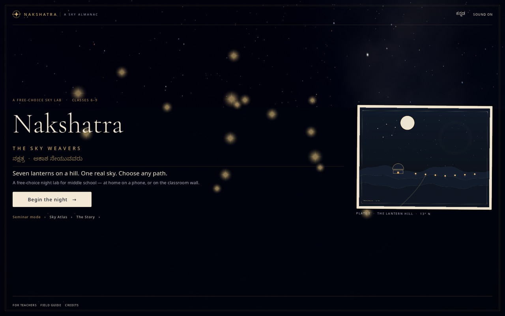
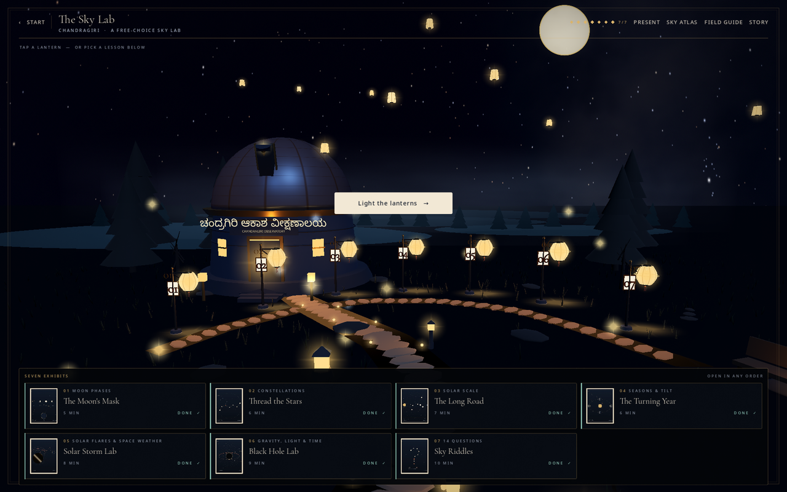
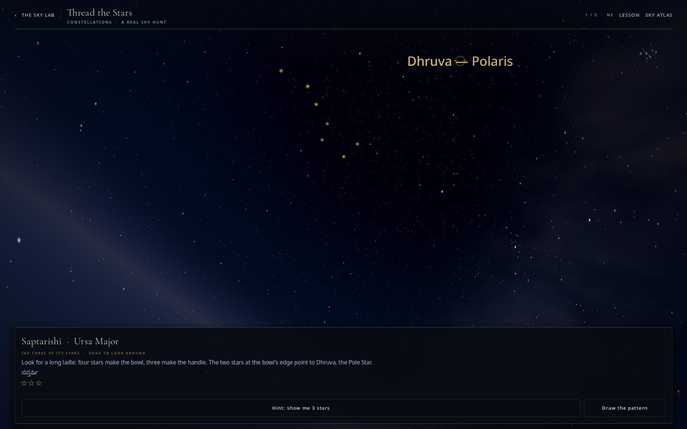
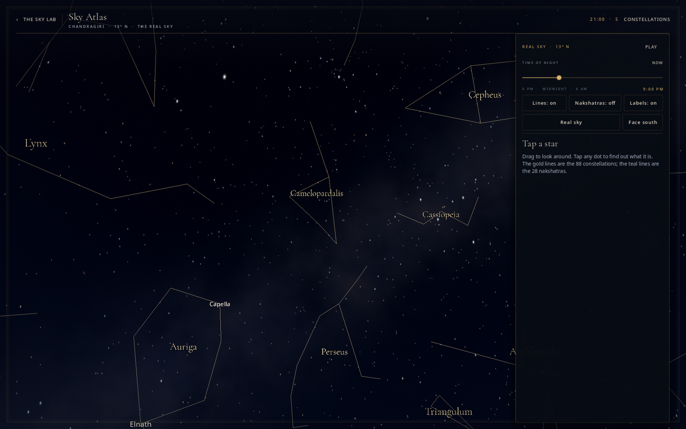
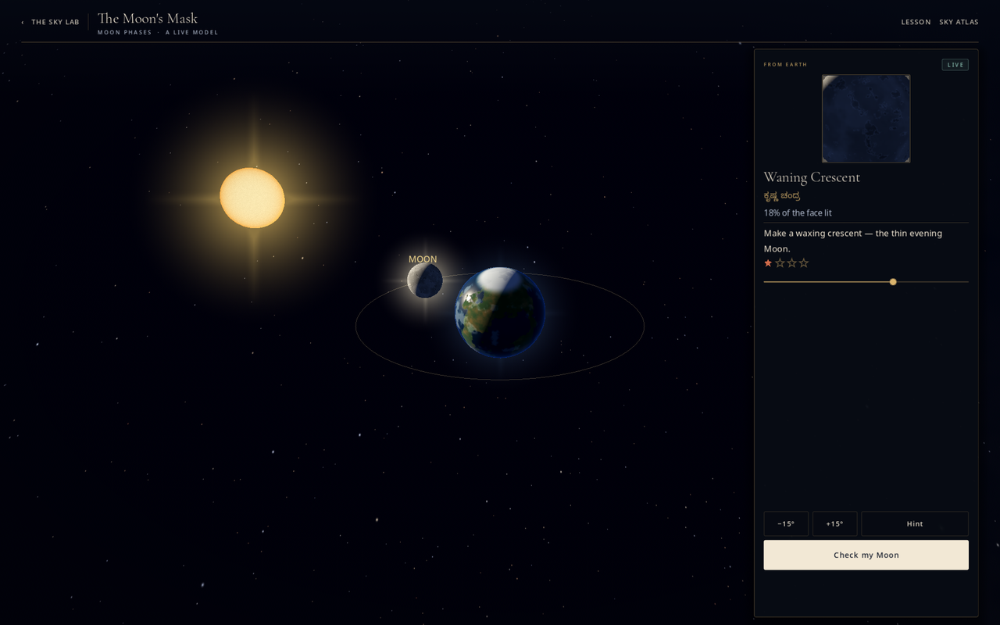
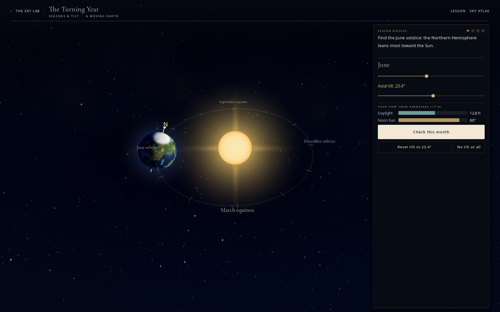

# Art direction — *Nakshatra*

> A night sky is not a screensaver. It is a place you are allowed to walk into,
> carrying one small light.

This document is the visual contract for the game. It exists so that a new
contributor can add an exhibit without turning the hill back into a generic
low-poly demo, and so that the viva panel can see *why* each choice was made.

---

## 1. The north star

**An observatory almanac, torn out and taped to a wall.**

The reference is a small printed star atlas, a paper lantern, a brass meridian
ring, and a hill at 9 p.m. — then a teenager's poster wall: oversized condensed
type, acid-yellow stickers, red bars, hard offset shadows, and a ticker that
never quite sits still. Cream paper stays for reading; the menu is allowed to
be loud.

Three rules follow from that:

1. **Texture before polygon count.** A shader with paper grain and warm light
   pools reads richer than a high-poly asset with a flat material.
2. **One warm light, one cool dark, one electric hit.** The night is ink; the
   attention is acid yellow; vermilion and cyan are punctuation, not fields.
3. **Motion is percussion.** Hover lifts, press squashes, release springs, a
   result gets one stamp. Then the screen holds still. No ambient confetti;
   no animation that fights the text.

---

## 2. Visual grammar

### Palette

| Token | Hex | Use |
|---|---|---|
| `G.BG` | `#080710` | The night itself. Never pure black; pure black kills depth. |
| `G.INK` | `#191322` | Printed ink on paper, hard borders, button text. |
| `G.CREAM` | `#fff6e4` | Paper, primary type, the certificate. |
| `G.GOLD` | `#ffd23f` | Acid attention: CTA, constellation lines, the one accent that means “look”. |
| `G.GOLD_SOFT` | `#e6b92e` | Secondary gold; rules that should not shout. |
| `G.VERMILION` | `#ff4b3a` | The seal, the stamp, a single warm interruption. |
| `G.TEAL` | `#5ff2e3` | Nakshatra lines, hints, the “alive” state. |
| `G.MUTED` | `#bcb4ce` | Supporting copy. Never below 70% opacity on the night field. |

Rules:

- Gold is a **material**, not a text colour for paragraphs. At body size it
  loses contrast; use cream or muted blue-grey.
- Teal is the **Indian sky**. It should only appear on nakshatra geometry,
  hint rings, or a “found” state.
- Vermilion is rare. If three things on screen are vermilion, none of them is
  an accent any more.
- **Type:** Anton for every heading and control; Noto Sans for body; Noto Sans
  Kannada for the local script. Corners are square (0–1 px), borders are 2 px,
  shadows are hard offsets (4–8 px), never soft glows.
- **Reaction:** every button has hover lift, press squash, release spring, a
  quiet tick and a spark. A result is a physical stamp, not a grey toast.

### Type

- Display: the bundled serif (`UI.serif_font()`), generous tracking, old-style
  figures. Used for titles, the certificate, and constellation names.
- Body: the humanist sans (`UI.body_font()`); medium weight for lantern titles.
- Kannada: `UI.kannada_font()`, never faux-bold, never auto-translated.
- Micro-labels: uppercase, 8–10 px, 1.5–2 px tracking. They are the “printed
  caption under the plate” voice. If a micro-label needs a paragraph, it is not
  a micro-label.

### Paper and metal

| Surface | Treatment |
|---|---|
| Paper | `#f2e8d5` / `#efe0c4`, a hairline warm-brown border, a soft drop shadow, no gloss. |
| Brass | Gold base, roughness ~0.42, a thin darker seam. No chrome. |
| Ink ground | `ground_ink.gdshader`: fbm wash, warm vertex pools near lanterns, no tiling repetition. |
| Path | `path_ink.gdshader`: staggered flagstones, dark mortar, gilt dust in the cracks, warm emission near lanterns. |
| Lantern paper | `paper_lantern.gdshader`: unshaded, ribbed, belly-bright, slight flicker. |

The test: at 50 % brightness on a phone, the path should still be a path, the
lantern should still be a lantern, and the type should still be readable.

---

## 3. The hill

The hub is built **procedurally in code** (`scripts/world/SkyHill.gd`) rather
than assembled from imported assets. That keeps the web build small and every
lantern consistent, and it means the whole place is one readable file.

```
                  moon
        ✦                      ✦        sky lanterns
   ─────────────────────────────────────────────
        pine        observatory        pine
          ╲       (brass dome)        ╱
     01 ●───●───●───●───●───●───● 07     lantern trail
          ╲   stone path   ╱
             bench / cairn
```

### The seven lanterns

Seven paper lanterns on dark poles, numbered **01–07**, matching the seven
lesson cards 1:1. Each has:

- a lathe-turned paper body with bamboo caps and a tassel,
- a warm OmniLight and a ground pool,
- a painted number on the paper **and** a hanging cream tag, so the number
  survives at the distance of the hub camera,
- an `Area3D` for picking, a hover ring, and a title that appears only on hover.

The numbers are not decoration. They are the contract between the 3D place and
the 2D lesson grid. If a learner sees “03” on the hill, card 03 must be the same
exhibit.

### The trail

A narrow stone thread runs behind the lanterns and crosses the main path. It is
there to answer a composition problem: seven poles in a field read as seven
unrelated objects; seven poles on a trail read as one walk. The trail is
deliberately narrower and dimmer than the main path — it is a footpath, not a
road.

### The observatory

A brass-and-ink dome at `(-7.8, ·, -14.2)`, scale 1.32, with:

- a riveted dome (`dome_panel.gdshader`) and an open shutter,
- a telescope and a lens glint,
- a Kannada sign (`ಚಂದ್ರಗಿರಿ ಆಕಾಶ ವೀಕ್ಷಣಾಲಯ`) with an English subtitle,
- a warm doorway that acts as the visual anchor at the top of the path.

It is the destination of the path but **not** a locked door. The seven exhibits
are always open. The building is a promise, not a gate.

### Supporting cast

- **Bench + lamp** at the right edge: a place to sit, and a foreground scale cue.
- **Stone cairn** at the left edge: a hand-made marker, and a quiet asymmetry.
- **Pines and a bare tree**: silhouettes, not detailed models. They frame the
  sky and hide the edge of the ground.
- **Grass**: 650 MultiMesh blades, swaying in the `grass_blade` shader. Enough to
  catch the lantern light; not enough to cost a web frame.
- **Fireflies**: 16 points, slow, warm. They are the only thing allowed to
  twinkle in the foreground.
- **Mist / ridges**: layered `ridge.gdshader` silhouettes and two mist bands.
  They make the horizon feel like weather, not a cut-out.
- **Sky lanterns**: ten paper lights rising, each with its own speed and phase.
- **Shooting stars**: a single tapered ImmediateMesh ribbon, spawned 55–85 units
  ahead of the camera. Rare on purpose.

---

## 4. The sky

The sky is the one place where the game is allowed to be literal.

- **8,879 naked-eye stars** from HYG v3, with real colours and magnitudes.
- **88 IAU constellations**, gold line figures.
- **28 nakshatras**, teal lines, with Kannada names.
- The `sky.gdshader` dome is a painted atmosphere, not a cubemap: a deep navy
  gradient, a soft Milky Way band (`milky_strength 0.85`), no static “star dust”.
- The star sprite is a four-pointed paper glint, scaled per magnitude. In the
  title screen it is deliberately scaled down (`1.18`, intensity `1.02`) so it
  never competes with the headline. In the hunt it is scaled up (`1.9`) so the
  sky feels rich on a phone.
- Constellation labels are set in the serif face, gold, with a dark outline.
  They are allowed to be numerous because only a handful are in view at once.

### The hunt

`Thread the Stars` is a real-sky hunt, not a hidden-object puzzle. The five
hunts use the **classic seven-star figures** (curated HIP lists), so the clue
always matches the sky. The target stars carry a warm core and a soft breathing
halo: enough to reward looking, not enough to replace it. The auto-hint appears
after 16 seconds of stillness, and the manual hint rings three stars in teal for
six seconds. Polaris is named in the Saptarishi hunt because the clue points to
it; a small gold reticle anchors the label to the actual star.

### The Atlas

The Atlas is the “instrument” view: time scrubbing, real sky at 13° N, compass
facing, labels, constellation lines and nakshatra lines. It should feel like
turning a brass setting, not browsing a menu. A “NOW” link returns to the real
clock; the time readout is duplicated next to the slider so the control and the
value are never separated.

---

## 5. Motion

| Element | Motion | Why |
|---|---|---|
| Lanterns | `sin` sway, 0.4–0.8 Hz, amplitude 1–2° | Hand-made, hung paper. |
| Sky lanterns | rise 0.15–0.35 u/s, drift `sin` | The hill is alive at the edges. |
| Fireflies | 8 s lifetime, soft vertical drift | Depth without noise. |
| Shooting stars | one every 8–14 s, 0.5 s ribbon | A reward for looking up. |
| Camera (title) | ±0.22 u, 0.07 Hz | A held breath, not a bob. |
| Postcard (title) | ±0.55°, 5.2 s each way | Paper settles; it does not swing. |
| Certificate | 0.85 s alpha-in after 0.25 s | A page being set down. |
| UI | `UI.fade_in` 0.6–0.9 s; hover 0.12 s | Never pop. |

If a motion is faster than 0.12 s or uses `TRANS_ELASTIC`, it is probably wrong
for this game.

---

## 6. Shaders

All shaders are hand-written, small, and mobile-friendly. No screen-space
post-processing chain beyond the vignette and grain.

| Shader | What it does | Where |
|---|---|---|
| `sky.gdshader` | Painted dome, Milky Way, star dust, horizon gradient | every scene |
| `star.gdshader` | Four-point paper glint, magnitude colour/size | `SkyDome` |
| `line.gdshader` | Additive constellation/nakshatra lines | `SkyDome` |
| `ground_ink.gdshader` | fbm ink wash, warm lantern pools | hill |
| `path_ink.gdshader` | Flagstones, mortar, gilt dust, warm emission | hill path + trail |
| `paper_lantern.gdshader` | Ribbed paper, belly light, flicker | every lantern |
| `grass_blade.gdshader` | Swaying tapered blade, warm tip | hill |
| `dome_panel.gdshader` | Riveted brass meridian seams | observatory |
| `ridge.gdshader` | Layered hill/mist silhouettes | horizon |
| `planet.gdshader` | Banded/rocky planet surfaces | orrery |
| `earth.gdshader` | Day/night terminator, city lights | Moon lab, Solar lab |
| `moon.gdshader` | Phase-lit regolith | Moon lab |
| `sun_surface.gdshader` | Granulation + sunspots + stress | Solar lab |
| `accretion_disk.gdshader` | Turbulent disk + Doppler-ish warmth | Black hole lab |
| `vignette.gdshader` | Edge falloff, no colour shift | every UI |

Shader rules:

- Every shader must compile in the GL Compatibility renderer; no compute, no
  screen texture unless it is the vignette.
- Every shader gets a **named parameter** rather than a magic number in the
  material setup. If a number matters to the art direction, it belongs in the
  shader header.
- No `TIME`-driven high-frequency noise. Slow is the brand.

---

## 7. Readability and access

- **Minimum body size**: 14 px at 1280×720; 13 px on compact.
- **Minimum contrast**: body copy is cream or >70 % muted on `#060910`. Gold is
  reserved for labels at 9 px or larger with an outline.
- **Phone first**: every screen is checked at 390×844 portrait. The 3D hub drops
  to six visible cards with a “more” affordance; the sky hunt panel stacks; the
  atlas panel becomes a sheet.
- **Tap targets**: 44 px minimum; lantern `Area3D` radius is generous.
- **Reduced motion**: the game does not require motion to understand any lesson.
  If a device is slow, the shaders degrade to flat colours before the layout
  changes.
- **No colour-only meaning**: done/locked is a check and a lit lantern, not just
  green.

---

## 8. What is deliberately *not* here

- No photoreal textures, no HDRIs, no imported 3D models. The hill is code and
  shaders; the sky is real data.
- No lens-flare post chain. The four-point glints are sprites/shader work, not a
  screen effect.
- No loot, streaks, badges or confetti. The reward is the sky and the
  certificate.
- No fake “AI” voice. Every label is written by a person and checked against the
  content.

---

## 9. Extending the hill

1. **Add a lantern**: append a spot to `SPOTS` in `SkyHill.gd`, add a module to
   `G.MODULES`, and add its card to the lesson grid. The number is derived from
   `G.MODULES`, so it stays in sync.
2. **Add a shader**: put it in `shaders/`, expose named parameters, and preview
   it in `tests/WorldPreview.tscn` before wiring it into `Lab`.
3. **Add an exhibit**: one scene, one script, one content entry. Keep the 3D
   scene readable at 1280×720 and 390×844; use `UI.app_bar`, `UI.panel`,
   `UI.button`, `UI.micro`.
4. **Add a hunt**: add the constellation to `StarDB` and a curated HIP list to
   `MAIN_STARS` in `StarLab.gd`. Do not rely on “brightest seven”; curate the
   figure.

---

## 10. QA set

The art pass is considered complete when these frames have been inspected at
1280×720 landscape and 390×844 portrait:

- Title (postcard visible, CTA readable, no star behind the headline)
- Hub (seven numbers readable, trail continuous, no lantern clipping the dome)
- Each of the seven labs (no object clipping; labels not overlapping)
- Star hunt (the figure findable in under 30 s without the hint)
- Atlas (labels legible; time value next to the slider)
- Finale 1/7 and 7/7 (the certificate does not bury the sky; the horizon fills
  the lower third)
- Seminar slide 1 and a figure slide (no tooltip overlap; one primary CTA)

The current reference captures live in `docs/img/` and
`build/web/` after `godot --export-release "Web"`.

The public playable build is at
https://g1gowda123.github.io/nakshatra/ and the source is at
https://github.com/g1gowda123/nakshatra.

---

## 11. Reference frames

These are captured from the build, not mockups. They are the visual baseline for
future work.


*The title: a quiet sky, a cream plate, one clear invitation.*


*The hub: seven numbered lanterns, a continuous trail, the observatory as anchor.*


*The hunt: seven warm cores, a named Dhruva, no drawn answer until asked.*


*The Atlas: real sky, readable labels, the time value next to the slider.*


*The finale: a certificate, seven lights, and a horizon that belongs to the hill.*


*The Moon lab: an inclined orbit and a Moon that stays visible.*


*The Turning Year: June on the June-solstice mark, the axis leaning sunward.*

